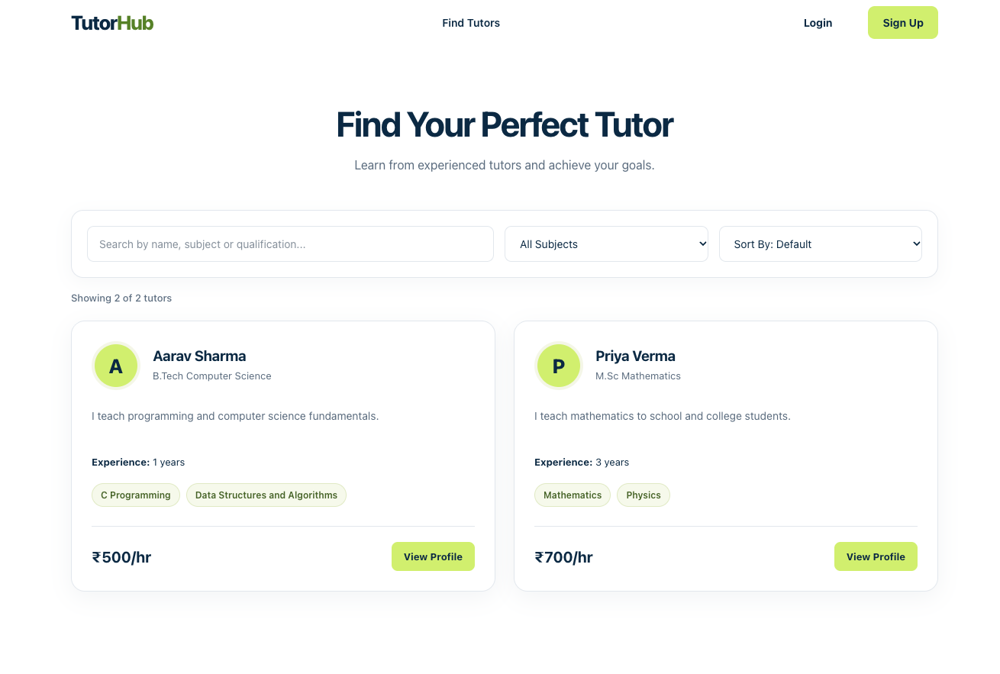
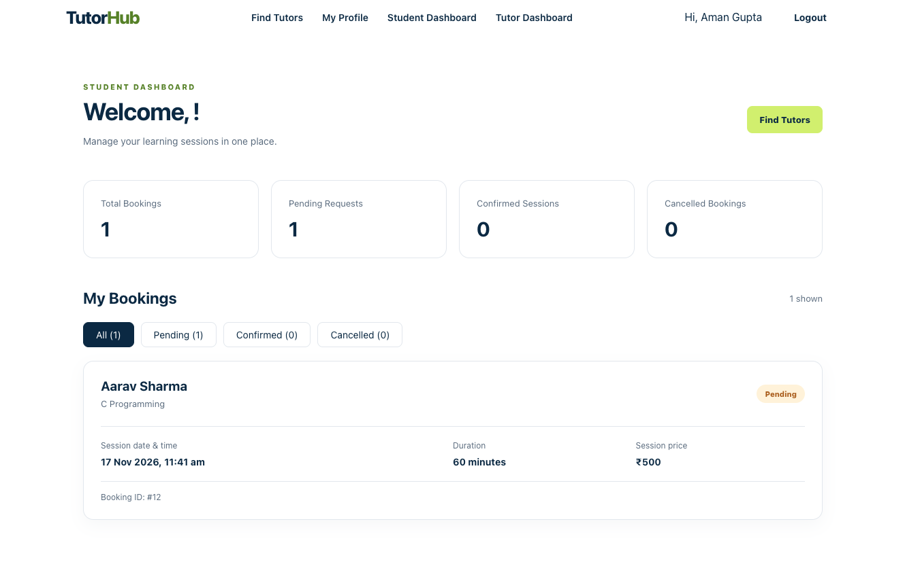
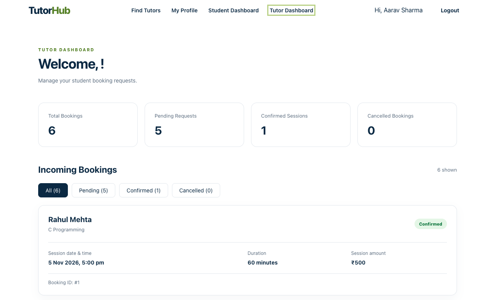
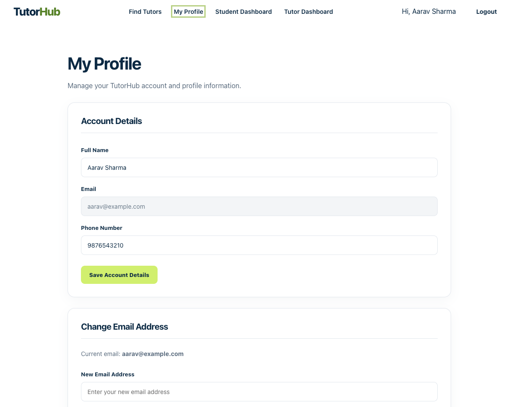

# TutorHub — Full-Stack Tutoring Marketplace

TutorHub is a full-stack tutoring marketplace that connects students with tutors. Users can register as students, tutors, or both, discover tutors, manage their profiles, and manage tutoring session bookings.

The project is built with **React, Node.js, Express.js, and PostgreSQL**, with a focus on authentication, role-based access control, REST APIs, relational database design, and responsive user interfaces.

## Screenshots

### Homepage


### Tutor Discovery


### Student Dashboard


### Tutor Dashboard


### Profile Management


## Features

### Authentication and User Management
- Student, tutor, and dual-role registration.
- Password hashing using bcrypt.
- JWT-based authentication with HttpOnly cookies.
- Session restoration and logout.
- Protected routes and role-based navigation.

### Tutor Discovery
- Browse available tutors.
- View individual tutor profiles.
- Search by name, qualification, bio, and subject.
- Filter tutors by subject.
- Sort by hourly rate and teaching experience.

### Student and Tutor Dashboards
- Separate dashboards for students and tutors.
- View bookings and booking status counts.
- Filter bookings by status.
- Tutors can confirm or reject pending booking requests.
- Students can cancel eligible bookings.
- Tutors can cancel confirmed bookings or mark them as completed.

### Profile Management
- Update shared account information.
- Manage student profile details.
- Manage tutor qualifications, experience, hourly rate, bio, and teaching subjects.
- Request email changes with email verification.

### Booking System
- Booking creation API with input validation.
- Student and tutor booking retrieval.
- Role-aware booking status transitions.
- Server-side ownership and authorization checks.
- Validation of supported session durations and future booking dates.
- Database-level prevention of overlapping pending or confirmed tutor bookings.

## Technology Stack

| Layer | Technologies |
|---|---|
| Frontend | React, React Router, Vite |
| Styling | CSS |
| Backend | Node.js, Express.js |
| Database | PostgreSQL |
| Authentication | JWT, bcrypt, HttpOnly cookies |
| Database Driver | node-postgres (`pg`) |
| Email Service | Resend |
| Testing | Vitest, Supertest, React Testing Library |
| Development Tools | VS Code, Git, GitHub |

## Project Structure

```text
tutorhub/
├── client/
│   └── src/
│       ├── components/
│       │   ├── Navbar.jsx
│       │   ├── ProtectedRoute.jsx
│       │   └── ProtectedRoute.test.jsx
│       ├── context/
│       │   ├── AuthContext.js
│       │   ├── AuthProvider.jsx
│       │   └── useAuth.js
│       ├── pages/
│       │   ├── Login.jsx
│       │   ├── Register.jsx
│       │   ├── Tutors.jsx
│       │   ├── TutorProfile.jsx
│       │   ├── StudentDashboard.jsx
│       │   ├── StudentDashboard.test.jsx
│       │   ├── TutorDashboard.jsx
│       │   ├── TutorDashboard.test.jsx
│       │   ├── Profile.jsx
│       │   └── VerifyEmailChange.jsx
│       ├── services/
│       │   ├── authService.js
│       │   ├── bookingService.js
│       │   ├── profileService.js
│       │   └── tutorService.js
│       ├── test/
│       │   └── setup.js
│       ├── App.jsx
│       ├── App.test.jsx
│       ├── App.css
│       ├── index.css
│       └── main.jsx
│
├── server/
│   ├── db/
│   │   ├── schema.sql
│   │   └── migrations/
│   │       ├── 001_add_database_validation_constraints.sql
│   │       └── 002_add_profile_text_constraints.sql
│   ├── src/
│   │   ├── db/
│   │   │   └── pool.js
│   │   ├── middleware/
│   │   │   └── authMiddleware.js
│   │   ├── routes/
│   │   │   ├── authRoutes.js
│   │   │   ├── bookingRoutes.js
│   │   │   ├── profileRoutes.js
│   │   │   └── tutorRoutes.js
│   │   ├── services/
│   │   │   └── emailService.js
│   │   ├── app.js
│   │   └── server.js
│   ├── tests/
│   │   ├── app.test.js
│   │   └── setup.js
│   ├── .env.example
│   ├── vitest.config.js
│   └── package.json
│
├── screenshots/
├── PROJECT_PROGRESS.md
├── README.md
└── .gitignore
```

## Database Design

TutorHub uses PostgreSQL and a relational database structure.

| Table | Purpose |
|---|---|
| `users` | Stores shared account information |
| `students` | Stores student-specific information |
| `tutors` | Stores tutor-specific information |
| `subjects` | Stores available subjects |
| `tutor_subjects` | Maps tutors to their teaching subjects |
| `bookings` | Stores tutoring session bookings |
| `email_change_requests` | Manages email-change verification |

### Multiple-Role Architecture

A single account can have:
- Student role.
- Tutor role.
- Both student and tutor roles.

Shared account information is stored in `users`, while role-specific information is maintained in the corresponding profile tables.

### Database Constraints and Validation

The database enforces important business rules, including:

- Non-negative tutor hourly rates.
- Tutor experience between 0 and 60 years.
- Supported booking durations of 30, 60, 90, or 120 minutes.
- Booking end times matching the selected duration.
- Tutor biography and student learning-goal length limits.
- Valid booking statuses.

### Booking Conflict Prevention

PostgreSQL uses the `btree_gist` extension and an exclusion constraint to prevent overlapping pending or confirmed bookings for the same tutor.

The booking time range uses `[)`, allowing one session to begin exactly when another session ends.

## Getting Started

Follow these instructions to run TutorHub locally.

### Prerequisites

Install:

- Node.js (developed using Node.js 24).
- npm.
- PostgreSQL.
- Git.

### 1. Clone the Repository

```bash
git clone https://github.com/savarna7/tutorhub.git
cd tutorhub
```

### 2. Set Up the Database

Create a PostgreSQL database:

```sql
CREATE DATABASE tutorhub;
```

Initialize the database using the schema file from the project root:

```bash
psql -h localhost -p 5433 -U your_postgres_username -d tutorhub -v ON_ERROR_STOP=1 -f server/db/schema.sql
```

The schema file defines the database tables, relationships, indexes, extensions, and constraints.

**Important:** `schema.sql` is the complete baseline schema for a new database. The numbered migration files are incremental changes for databases created from an older schema. Do not apply those migrations again to a database already initialized using the latest schema, because their constraints may already exist.

### 3. Set Up the Backend

```bash
cd server
npm install
```

Create your environment file:

```bash
cp .env.example .env
```

Update `server/.env` with your local configuration:

```env
PORT=5001
NODE_ENV=development

DB_HOST=localhost
DB_PORT=5432
DB_NAME=tutorhub
DB_USER=your_postgres_username
DB_PASSWORD=your_postgres_password

JWT_SECRET=your_long_random_secret

RESEND_API_KEY=your_resend_api_key

CLIENT_URL=http://localhost:5173
```

Use your own PostgreSQL credentials and a strong, randomly generated JWT secret.

Start the backend:

```bash
npm run dev
```

Backend URL:

`http://localhost:5001`

API base URL:

`http://localhost:5001/api`

Health check:

`http://localhost:5001/api/health`

### 4. Set Up the Frontend

Open another terminal from the project root:

```bash
cd client
npm install
npm run dev
```

Frontend URL:

`http://localhost:5173`

## API Overview

### Authentication

| Method | Endpoint | Purpose |
|---|---|---|
| POST | `/api/auth/register` | Register a user |
| POST | `/api/auth/login` | Authenticate a user |
| GET | `/api/auth/me` | Retrieve the current session |
| POST | `/api/auth/logout` | Log out |

### Tutors

| Method | Endpoint | Purpose |
|---|---|---|
| GET | `/api/tutors` | Retrieve tutors |
| GET | `/api/tutors/subjects` | Retrieve available subjects |
| GET | `/api/tutors/:tutorId` | Retrieve tutor details |

### Bookings

| Method | Endpoint | Purpose |
|---|---|---|
| GET | `/api/bookings/student/:studentId` | Retrieve student bookings |
| GET | `/api/bookings/tutor/:tutorId` | Retrieve tutor bookings |
| POST | `/api/bookings` | Create a booking |
| PATCH | `/api/bookings/:bookingId/status` | Update booking status |

Booking status transitions are validated according to the authenticated user's role and the booking's current status.

### Profiles

| Method | Endpoint | Purpose |
|---|---|---|
| GET | `/api/profiles/me` | Retrieve the current profile |
| PUT | `/api/profiles/account` | Update account information |
| PUT | `/api/profiles/student` | Update student information |
| PUT | `/api/profiles/tutor` | Update tutor information |
| POST | `/api/profiles/request-email-change` | Request an email change |
| POST | `/api/profiles/verify-email-change` | Verify and complete an email change |

Protected profile and booking operations require authentication.

## Testing

TutorHub includes automated backend and frontend test suites.

### Backend Tests

Tools:
- Vitest.
- Supertest.

Test file: `server/tests/app.test.js`

Coverage includes:
- Health and database connection endpoints.
- Registration and authentication.
- Profile and account management.
- Booking creation, retrieval, and status transitions.
- Email-change verification and edge cases.
- Input validation and authorization.
- Database constraint behavior.

Run backend tests:

```bash
cd server
npm test
```

### Frontend Tests

Tools:
- Vitest.
- React Testing Library.
- jest-dom.
- user-event.

Coverage includes:
- Application rendering.
- Protected routes and role-based access.
- Login and registration.
- Student dashboard behavior.
- Tutor dashboard behavior.

Run frontend tests:

```bash
cd client
npm test
```

### Latest Automated Test Results

| Test suite | Passing tests |
|---|---:|
| Backend | 65 |
| Frontend | 57 |
| **Combined total** | **122** |

Latest recorded runs passed all 122 tests.

The frontend production build also completed successfully.

### Additional Quality Checks

Frontend lint:

```bash
npm run lint --prefix client
```

Frontend production build:

```bash
npm run build --prefix client
```

Frontend dependency audit:

```bash
npm audit --prefix client
```

The latest recorded frontend dependency audit reported zero vulnerabilities.

**Backend test safety:** Automated backend tests use a separate PostgreSQL database named `tutorhub_test`. Never configure automated tests to use the development database.

## Environment Variables and Security

Never commit actual `.env` files, database passwords, JWT secrets, or API keys.

The repository includes `server/.env.example` as a configuration template.

Authentication uses HttpOnly cookies to reduce direct JavaScript access to the JWT.

Email verification uses Resend. Production email delivery requires a verified sending domain and appropriate sender configuration.

## Current Project Status

### Implemented
- Multi-role registration and authentication.
- Student, tutor, and dual-role accounts.
- Protected routes and role-based navigation.
- Tutor discovery, search, filtering, and sorting.
- Student and tutor dashboards.
- Profile management and tutor subject management.
- Email-change verification.
- Booking API with authorization and validation.
- Database-level booking overlap prevention.
- Booking status transition validation.
- Automated backend and frontend tests.
- Database schema and incremental migrations.

### Further Work
- Complete end-to-end booking creation through the React interface.
- Broader marketplace workflow testing.
- Expand frontend automated test coverage.
- Review remaining security and production-readiness considerations.
- Configure production email delivery.
- Deploy the application.

TutorHub is an actively developed portfolio project. Passing automated tests does not mean every feature has been verified in a deployed, end-to-end environment.

## Future Improvements

- Expand automated integration and end-to-end tests.
- Improve booking and marketplace workflows.
- Review validation, error handling, and security.
- Configure production email delivery.
- Deploy the frontend, backend, and database.
- Add a live application demo.

## Author

**Savarna Mallick**

B.Tech Computer Science and Engineering Student

GitHub: [@savarna7](https://github.com/savarna7)

## Repository

[https://github.com/savarna7/tutorhub](https://github.com/savarna7/tutorhub)